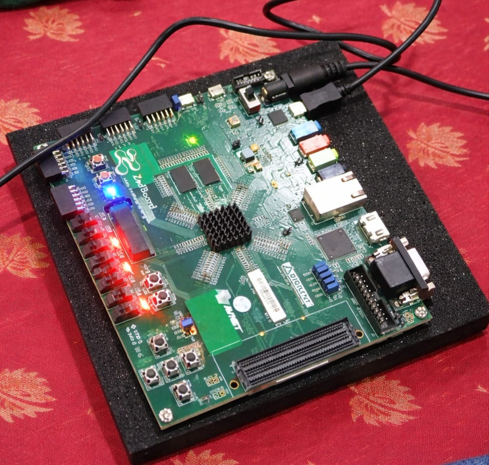
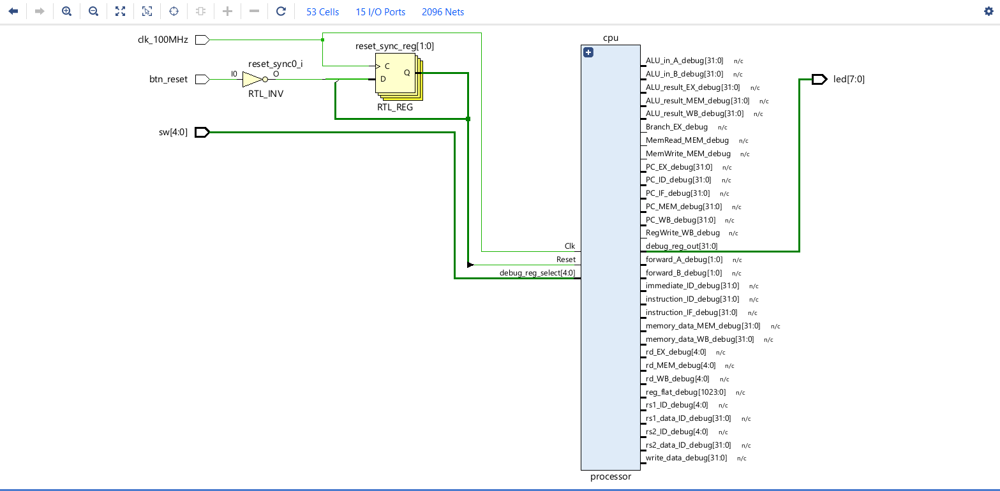
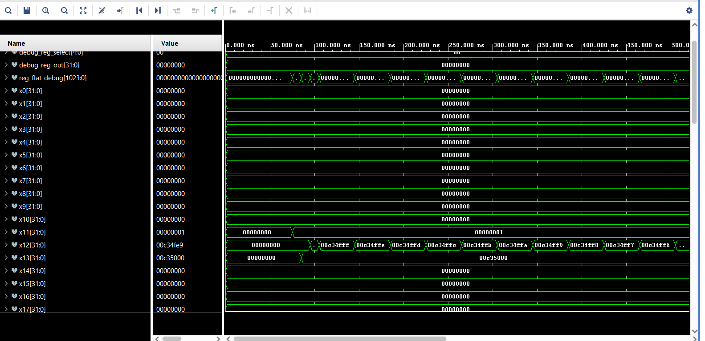
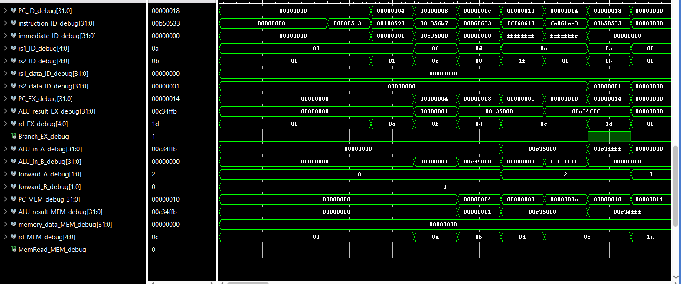
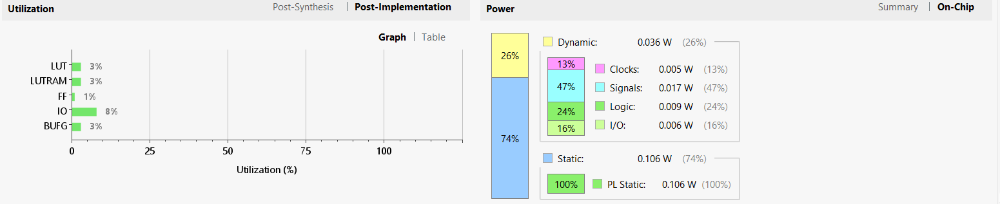

# 5-Stage Pipelined RISC-V Processor (RV32I)

A 32-bit RISC-V (RV32I) processor in Verilog with a classic 5-stage pipeline, data forwarding, load-use stall detection and branch flushing.
Simulated in Vivado xsim and Icarus Verilog, and run on a **Digilent ZedBoard (Zynq XC7Z020)**, where the switches select a register and the LEDs show its value.

**Authors:** Sreevenkat Eluva, Aryan Asit



---

## Features

* **RV32I base integer ISA**: the 37 instructions listed below (FENCE, ECALL and EBREAK are not implemented)
* **5-stage pipeline**: IF, ID, EX, MEM, WB with pipeline registers IF/ID, ID/EX, EX/MEM, MEM/WB
* **Forwarding unit**: EX/MEM and MEM/WB results are bypassed to the ALU inputs, so back-to-back dependent instructions do not stall
* **Hazard detection unit**: a load followed by an instruction that uses the loaded register stalls for 1 cycle
* **Branch flush**: branches and jumps are resolved in EX; a taken branch or jump flushes the two wrong-path instructions
* **Byte and halfword memory access**: LB, LH, LBU, LHU, SB, SH with byte offsets in the data memory
* **FPGA debug interface**: `sw[4:0]` selects a register, `led[7:0]` shows its lower 8 bits

| Pipeline behaviour | Cycles |
|---|---|
| Throughput without hazards | 1 instruction per cycle (after the pipeline fills) |
| Dependent ALU instruction (forwarded) | 0 stall |
| Load-use dependency | 1 stall |
| Taken branch / JAL / JALR | 2 (IF/ID and ID/EX flushed) |
| Not-taken branch | 0 |

---

## Microarchitecture

| Stage | Main blocks (`src/`) |
|---|---|
| IF | `PC.v`, `PC_adder.v`, `instruction_mem.v`, `IF_ID_pipe_reg.v` |
| ID | `main_control_unit.v`, `register_file.v` (32 x 32 bit, x0 = 0), `imm_gen.v` (I, S, B, U, J), `hazard_detection_unit.v`, `ID_EX_pipe_reg.v` |
| EX | `ALU.v`, `ALU_control_unit.v`, `forwarding_unit.v`, `mux.v`, `mux4to1.v`, branch target `adder.v`, `EX_MEM_pipe_reg.v` |
| MEM | `data_memory.v` (1024 words, byte/halfword access), `MEM_WB_pipe_reg.v` |
| WB | write-back mux: ALU result, load data or PC + 4 (JAL/JALR) |

`processor.v` connects the stages; `top.v` is the FPGA wrapper (100 MHz clock, synchronised reset button, switches, LEDs).

Vivado RTL schematic of the top level:



---

## Supported instructions

| Category | Instructions |
| :--- | :--- |
| Register-register | `ADD`, `SUB`, `SLL`, `SLT`, `SLTU`, `XOR`, `SRL`, `SRA`, `OR`, `AND` |
| Register-immediate | `ADDI`, `SLTI`, `SLTIU`, `XORI`, `ORI`, `ANDI`, `SLLI`, `SRLI`, `SRAI` |
| Load / store | `LW`, `LH`, `LB`, `LHU`, `LBU`, `SW`, `SH`, `SB` |
| Branch / jump | `BEQ`, `BNE`, `BLT`, `BGE`, `BLTU`, `BGEU`, `JAL`, `JALR` |
| Upper immediate | `LUI`, `AUIPC` |

---

## Results

### Simulation

Vivado xsim, register file view (`x11`, `x12`, `x13` change as the program runs):



Pipeline signals: PC and instruction per stage, immediate, register addresses, ALU inputs and result, and the forwarding selects
(`forward_A = 2` while a result is bypassed from EX/MEM):



### FPGA implementation (ZedBoard, Vivado)

Post-implementation utilization: about 3 % of the LUTs and 1 % of the flip-flops. Vivado on-chip power estimate 0.142 W (0.036 W dynamic, 0.106 W static).



---

## Run the simulation

With Icarus Verilog (from the repository root):

```bash
cd src
iverilog -g2012 -o sim *.v
vvp sim
```

The testbench (`tb.v`) prints the PC and instruction in IF and the write-back of every cycle, then dumps all 32 registers and writes
`processor_tb.vcd` for GTKWave. With the default `program.mem`:

```
addi x1, x0, 5      -> x1 = 5
addi x2, x1, 1      -> x2 = 6   (x1 forwarded)
add  x3, x2, x2     -> x3 = 12
jal  x0, 0          -> loop
```

In Vivado, add `src/*.v` as design sources, `tb.v` as the simulation source and `program.mem` / `data.mem` as memory files.

To run another program, put its machine code (one 32-bit hex word per line) in `src/program.mem`. Example programs are in `demo_programs/`:
`sum_of_n_numbers.txt` and `LED_BLINKING.txt`.

### On the ZedBoard

Use `top.v` as the top module with `src/constraints.xdc`, generate the bitstream and program the board.

* `sw[4:0]`: register index (0-31)
* `led[7:0]`: lower 8 bits of the selected register
* reset button: restart from PC = 0

---

## Repository structure

```
src/
  processor.v               pipeline top (all stages)
  top.v                     FPGA wrapper (clock, reset sync, switches, LEDs)
  *_pipe_reg.v              IF/ID, ID/EX, EX/MEM, MEM/WB pipeline registers
  forwarding_unit.v         data forwarding
  hazard_detection_unit.v   load-use stall
  main_control_unit.v       opcode decode
  ALU.v, ALU_control_unit.v
  register_file.v, imm_gen.v, PC.v, PC_adder.v, adder.v, mux.v, mux4to1.v
  instruction_mem.v, data_memory.v
  program.mem, data.mem     instruction and data memory contents
  constraints.xdc           ZedBoard pins
  tb.v                      testbench
demo_programs/              example programs (machine code)
results/                    schematic, waveforms, utilization/power report, board photo
```

---

## Future work

* AXI4-Lite or AHB bus interface and an SoC wrapper with UART and GPIO
* Branch prediction (BTB + 2-bit counters) to reduce the 2-cycle taken-branch penalty
* FENCE, ECALL, EBREAK and the M extension (multiply/divide)
* Instruction and data caches
* A self-checking test program per instruction class

---

## Authors

* **Sreevenkat Eluva**
* **Aryan Asit**

## License

Open source for academic and learning purposes.
